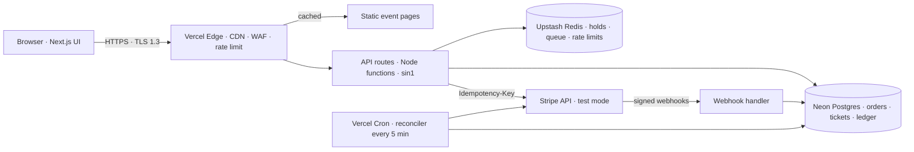

# TicketRush — System Design (v0.1, draft for approval)

## 1. Architecture at a glance



| Layer | Choice | Why |
|---|---|---|
| App | Next.js (App Router) on Vercel, Node runtime | One codebase, edge caching for read-heavy pages, serverless scale-out for spikes |
| Region | Functions in Singapore (`sin1`), DB in the same region | Keep function → DB latency in single-digit ms |
| Database | Neon Postgres (pooled connections) | Transactions, row locks and unique constraints are what make money correct |
| Cache / coordination | Upstash Redis | Atomic seat holds, waiting-room queue, rate limiting, all in < 2 ms |
| Payments | `PaymentGateway` adapter: Stripe PaymentIntents + Elements (default) or Razorpay Orders (test mode) | Idempotency keys, signed webhooks, card data never on our servers; gateway is swappable |
| Jobs | Vercel Cron → reconciler endpoint | Catches anything a webhook missed |
| Auth | Auth.js with database sessions | Opaque session ID in an httpOnly cookie, revocable server-side |

## 2. Data model (Postgres)

```
users(id, email, name_enc, phone_enc, created_at)
events(id, title, starts_at, venue, on_sale_at, status)
seats(id, event_id, section, row, number, price_cents)            -- static inventory
orders(id, user_id, event_id, status, amount_cents, idem_key UNIQUE, stripe_pi UNIQUE, hold_expires_at, created_at)
order_items(order_id, seat_id)
tickets(id, order_id, event_id, seat_id, qr_sig, issued_at, UNIQUE(event_id, seat_id))   -- the double-sell guard
payment_events(stripe_event_id PRIMARY KEY, type, payload, processed_at)                -- webhook dedupe
refunds(id, order_id, stripe_refund_id UNIQUE, reason, status, created_at)
audit_log(id, actor_id, action, target, ip_hash, at)
```

Order states: `pending → paid → ticketed` or `pending → expired`, and `paid → refund_pending → refunded` when tickets can't be issued. Every transition is written in one transaction with an audit entry.

## 3. The checkout path (and how each failure is handled)

1. **Waiting room.** When an event is hot, arrivals get a signed queue token (Redis sorted set by arrival time). A release job admits N buyers per second; admitted buyers get a short-lived admission cookie. Everyone else sees their real position.
2. **Seat hold.** `SET hold:{event}:{seat} {order} NX EX 600` per seat, in one Lua script so a multi-seat hold is all-or-nothing. Two people clicking the same seat in the same millisecond: exactly one wins, the other is told immediately.
3. **Order.** Insert a `pending` order with `idem_key` (client-generated UUID per checkout attempt). A double-click or retried request hits the unique constraint and returns the same order.
4. **PaymentIntent.** Created server-side with the price **read from the database**, never from the request, and `Idempotency-Key = order.id`. If Stripe times out, we retry with the same key; Stripe returns the same PaymentIntent, so no second charge is possible.
5. **Confirm.** The browser confirms with Stripe Elements. Card data goes straight to Stripe.
6. **Webhook `payment_intent.succeeded`.** Verify the Stripe signature → insert `stripe_event_id` (duplicate deliveries are ignored) → in one transaction, `SELECT … FOR UPDATE` the order and insert tickets. The `UNIQUE(event_id, seat_id)` constraint is the final word: even if Redis lost a hold, Postgres cannot issue the same seat twice.
7. **Can't issue tickets?** (hold expired and seat taken, or event cancelled) → order goes to `refund_pending` → refund via Stripe with `Idempotency-Key = refund:{order.id}` → `refunded`, and the buyer is emailed.

| Failure | What happens |
|---|---|
| Gateway timeout while creating payment | Retry with same idempotency key → same PaymentIntent, never a second charge |
| Gateway down entirely | Circuit breaker opens after repeated failures; buyers keep their hold and see "payments paused, your seats are held"; holds are extended while the breaker is open |
| Webhook never arrives | Reconciler (every 5 min) lists recent PaymentIntents from Stripe and compares with orders; any paid-but-unticketed order is ticketed or refunded |
| Webhook arrives twice / out of order | `payment_events` primary key dedupes; state machine ignores invalid transitions |
| Our server crashes after the charge | Stripe retries the webhook for up to 3 days and the reconciler catches it sooner |
| 3,000 people pay at once | Admission rate limits concurrency into checkout; Postgres row locks are per order, so payments don't block each other |
| Redis unavailable | Holds can't be placed → checkout pauses cleanly; Postgres constraints still prevent double-selling |

## 4. Security model

| Threat | Defence |
|---|---|
| Tampering from the browser console or a proxy (changing price, quantity, seat, order ID) | The server never trusts client values: price comes from the DB, seats are re-checked against the hold, every order/ticket lookup checks `user_id = session.user` (no IDOR). Tests cover each tampering case. |
| Session theft | Opaque session ID in an `httpOnly; Secure; SameSite=Lax` cookie, rotated on sign-in, revocable server-side; no tokens in localStorage |
| CSRF | SameSite cookies + Auth.js CSRF token on state-changing requests; webhook route is the only exception and is signature-verified instead |
| XSS | React escaping, strict Content-Security-Policy, no `dangerouslySetInnerHTML` |
| Bots and brute force | Vercel WAF rules + per-IP and per-user sliding-window rate limits in Redis; queue tokens are HMAC-signed and single-use |
| Forged webhooks | Stripe signature verification with the endpoint secret; replay window 5 min |
| Data at rest | Neon encrypts storage (AES-256); phone/name additionally encrypted per field with AES-256-GCM, key in Vercel env, key ID stored for rotation |
| Data in transit | TLS 1.3 browser → edge; TLS to Neon, Upstash and Stripe |
| Card data | Never touches our servers (Stripe Elements) |
| Fake tickets | QR payload = ticket ID + HMAC-SHA256 signature; scanner verifies signature and one-time use |
| Secrets | Only in Vercel environment variables, separate for preview/production; never in the repo (secret scanning on) |
| Supply chain | Locked dependencies, Dependabot, CodeQL on pull requests |

## 5. Network and performance
- Vercel's edge network terminates TLS close to the user and serves cached event pages; only API calls reach functions.
- Functions and Neon in the same region; Neon via its pooled endpoint so thousands of concurrent function instances don't exhaust connections.
- Redis over Upstash's HTTPS REST API (no long-lived connections needed in serverless).
- Seat availability is pushed from a cached snapshot refreshed every 2 s instead of one DB query per viewer.

### Implementation notes (milestone 5b)
- Seat holds currently live in Postgres (`seat_holds`, primary key on `seat_id`) rather than Redis: one SQL statement checks waiting-room admission, event status, seat validity and sold seats, releases the buyer's previous and any expired holds, and inserts the new hold. A single statement is atomic, so a primary-key conflict on any seat rolls back the whole hold.
- Checkout creates the order, its items and the audit entry in one statement; ticket issue, the status change, hold release and audit entry are one statement inside the order-locking transaction. Round trips per request: hold 2, checkout 4, payment → tickets 8 (measured in `docs/results/m5b-speed.md`).
- The function region (`sin1`) must match the database region; `/api/health` reports the round-trip time.

## 6. Testing plan
- **Unit + integration:** state machine, idempotency, authorization (Vitest, real Postgres in CI).
- **Concurrency:** 3,000 parallel buyers for 500 seats → assert exactly 500 tickets, zero duplicates.
- **Fault injection:** a gateway adapter that can time out, return 500s or drop webhooks at a set rate → assert zero orphaned charges after reconciliation.
- **Load (k6), $0:** runs in GitHub Actions (free for public repos). The workflow starts the production build of the app with Postgres and Redis service containers and a gateway mock behind the same adapter, then drives 10k virtual users browsing and 3k concurrent checkouts with fault injection. Gateway test modes (Stripe, Razorpay) are rate-limited, so the real test APIs are exercised separately at low volume for correctness. Results from both are published as-is, along with the runner's hardware so the numbers are read in context.
- **Live smoke test:** a small k6 run against the deployed Vercel app, kept within free-tier limits.
- **Security:** OWASP ZAP baseline scan, tampering tests, dependency audit.

## 7. Build order (milestones)
1. Skeleton: Next.js, DB schema, auth, CI, deployed to Vercel
2. Events + seat map + holds
3. Orders + Stripe PaymentIntents + webhooks
4. Refunds, reconciler, circuit breaker
5. Waiting room
6. Test suites: concurrency, fault injection, security
7. Load test + results page
8. Case study on the portfolio
